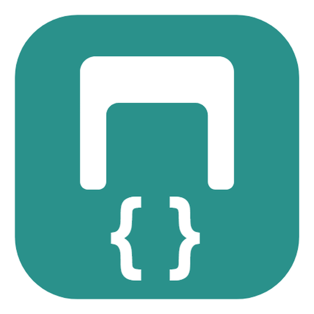

# aas-model

The lab's AAS model in full: the pydantic types of the product, process and resource AASs, the
submodel templates (IDTA's and the lab's own, ARSO's among them), building and reading them, and the
lab's instances (the stations, the planar table and its shuttles, the filling line, products and
processes). AASPIRE's tools build every AAS with it.

> Since 26 Nov 2026 this is where aas-model is developed: the lab's branch `lab-ppr-models` merged
> with Tristan Schwörer's line of [aas-model](https://github.com/tristan-schwoerer/aas-model)
> (`merge-lab-ppr-models`: the execution model, the Skills and Knowledge of every resource, the stations
> named by what they do, the AP2030 nameplate), with both histories.

| Where | What |
| --- | --- |
| `src/aas_model/` | The types (`resource_template`, `product_template`, `process_template`), the lab's submodel templates (`submodel_templates`), the builder, the instances (`resource_instances`, ...) |
| `src/aas_pydantic/` | The IDTA submodel templates as pydantic classes, and the conversion to and from BaSyx |
| `templates/` | The templates as JSON (`templates/arso` written by modreg from the ontology) |
| `docs/` | The model, one page per submodel (`docs/lab-submodels`), the lab's AASs (`docs/lab-aas.md`) |
| `scripts/` | Generating the classes from the templates; exporting instances |
| `submodel-templates/`, `MQTTSchemas/` | Submodules: IDTA's published templates, the MQTT message schemas |

```powershell
git clone --recurse-submodules https://github.com/AAU-AASPIRE/aas-model.git
python -m pip install -e .
python -m pytest
```

Part of [AASPIRE](https://github.com/AAU-AASPIRE/aaspire).
